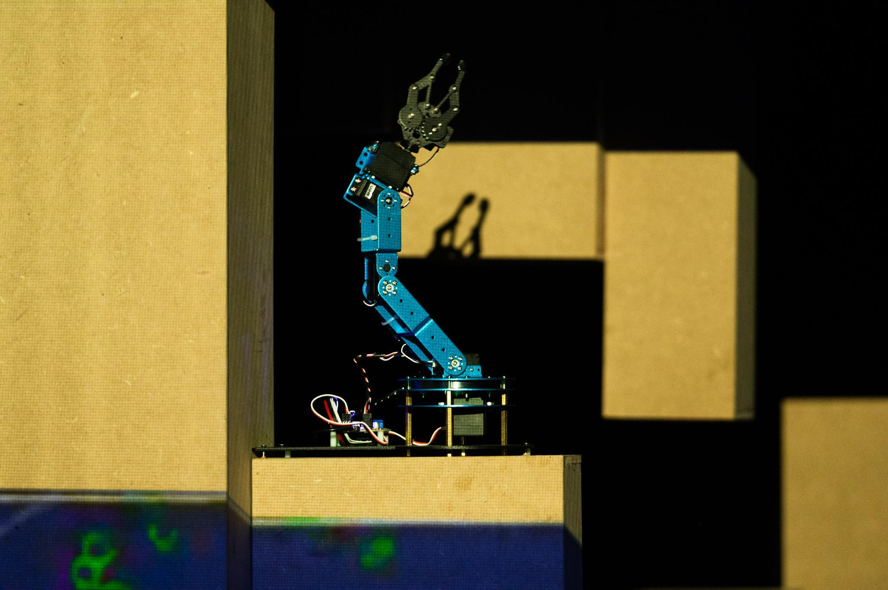
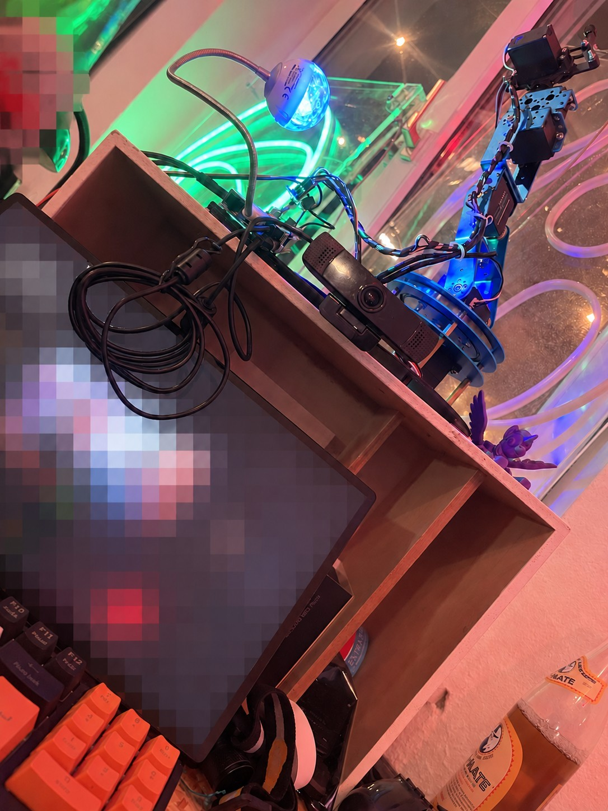
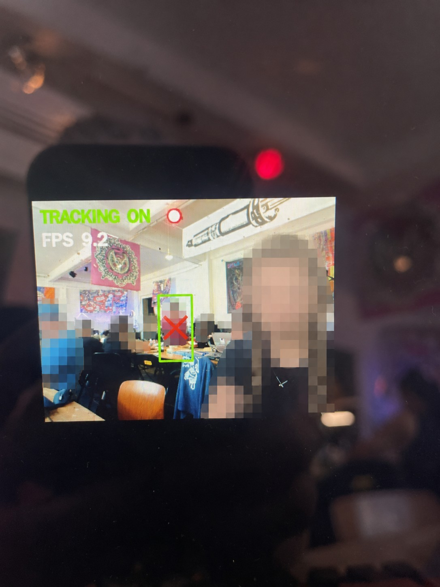
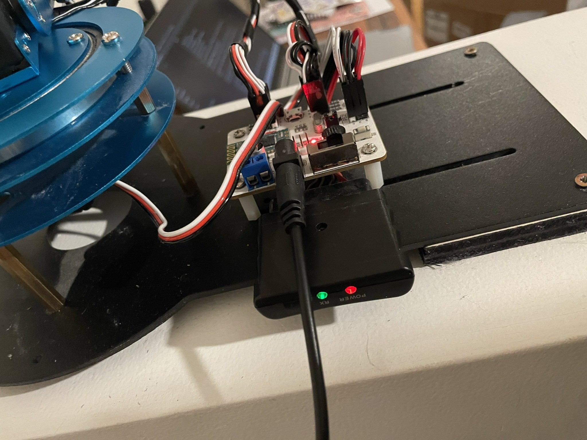
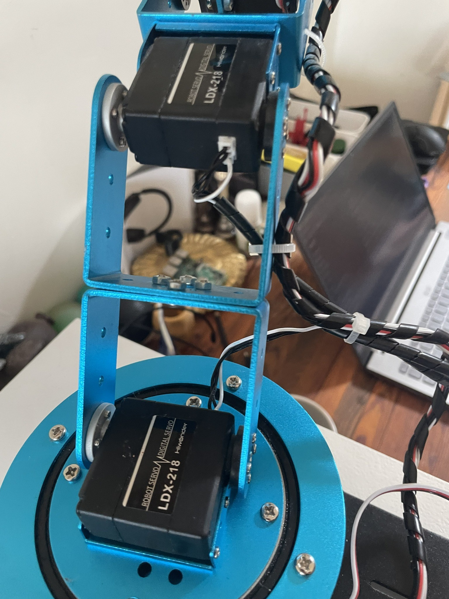
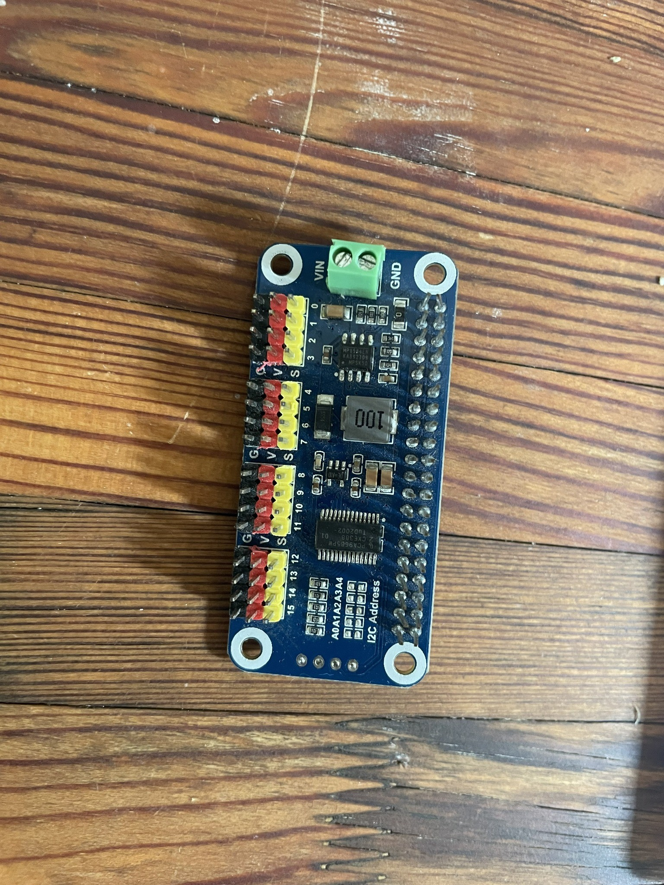
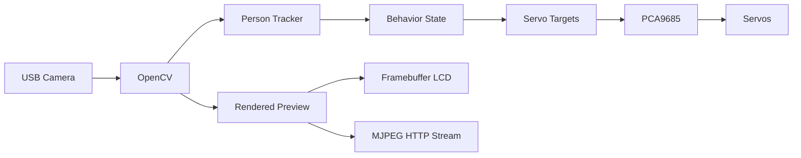

# Raspberry Pi Robot Arm

> [!WARNING]
> This is a physical robotic arm capable of causing injury. Keep people, hair, clothing, and loose objects clear during startup and `HOME`. Provide an accessible servo-power disconnect. Test every new movement range slowly. `Ctrl+C` or a service stop must disable PWM. Software limits do not replace continuous physical supervision.

A Raspberry Pi 5-controlled Hiwonder/LeArm robotic arm with camera-based person detection and tracking. The current build combines a PCA9685 servo controller at I2C address `0x40` and 50 Hz, six PWM servos, a USB camera, OpenCV, a mirrored framebuffer LCD preview, an optional MJPEG browser stream, and systemd startup.

This repository preserves the working controller plus calibration and experimental scripts. Many scripts can move real hardware. Read [SAFETY.md](docs/SAFETY.md) and [SERVO_MAPPING.md](docs/SERVO_MAPPING.md) before running anything.

## A Second Life for a Performing Robot

This robotic arm did not begin as a Raspberry Pi project. Its first life was on stage in [*Apofenija/1*](https://www.melara.si/apofenija-1/), a performance by Nina Ramšak Marković and Varja Hrvatin that treated robotic and technological entities as performers in their own right. I worked on the production as a technical co-author together with Staš Vrenko, and this arm was one of its machines.

<p align="center">
  
</p>

<p align="center"><em>The robotic arm in its earlier life as a performer in <a href="https://www.melara.si/apofenija-1/">Apofenija/1</a>. Photo: Gregor Salobir — used with permission.</em></p>

After the performance was retired, the arm was reused through Digital on Stage activities at KIBLA as a hands-on medium for exploring robotics in theatrical and performing-arts contexts. When its original controller board eventually died, I kept its "guts and muscles"—the mechanics, servos, wiring, and accumulated physical history—and replaced its brain during [Circuit Control](https://circuit-control.de/?lang=en) in Dresden. A Raspberry Pi 5 now supports computer-vision, tracking, streaming, autonomous-movement, interaction, and control experiments.

**Apofenija/1 → Digital on Stage / KIBLA → controller failure → Circuit Control rebuild → Raspberry Pi / OpenCV experiments → possible ROS or custom interfaces**

The project is not only about making an old robotic arm move again. It is an experiment in reuse, repair, adaptation, and technological afterlives: allowing one machine to move from performer, to workshop tool, to experimental autonomous robot without hiding its scratches, old servos, improvised wiring, obsolete components, repairs, or modifications. **Keep the body, replace the brain, and see what the machine can become next.**

The Raspberry Pi rebuild is not intended as a final form. Future work may separate the physical control layer from interfaces such as ROS or ROS 2, a custom browser interface, OSC or network control, tools for performers and workshop participants, and computer-vision-driven behaviours. See [the full project history](docs/HISTORY.md).

## Project gallery

<p align="center">
  
</p>

<p align="center"><em>Physical robot-arm setup with camera and local display. Screen content and bystanders are privacy-redacted.</em></p>

<p align="center">
  
</p>

<p align="center"><em>Local display showing the tracking overlay. People in the camera image are privacy-redacted.</em></p>

<table>
  <tr>
    <td align="center"><br><sub>Installed electronics</sub></td>
    <td align="center"><br><sub>Installed Hiwonder servos</sub></td>
    <td align="center"><br><sub>PCA9685 driver HAT</sub></td>
  </tr>
</table>

## Architecture



## Features and status

| Feature | Status in this snapshot |
| --- | --- |
| `FOLLOW` person tracking | Working in `person_follow_camera.py` |
| `GREET` gesture | Working after sustained centered engagement |
| `HAPPY_DANCE` | Constants/telemetry retained, but no reachable dance sequence is implemented in the checked-in controller |
| Mirrored LCD preview | Working through pygame or direct 16-bit `/dev/fb0` output |
| `HELLO` during greeting | Intended behavior; the current overlay shows tracking/behavior state rather than a literal `HELLO` label |
| MJPEG web stream | Implemented; enabled with `--web-stream` |
| Light-react mode | Separate experimental controller, not part of normal autostart |
| Demo/random motion | Separate experimental scripts, not part of normal autostart |

## Hardware

- Raspberry Pi 5
- Hiwonder/LeArm six-servo robotic arm
- PCA9685 PWM controller (`0x40`, 50 Hz)
- Six PWM servos on channels 0–5
- USB camera
- Framebuffer LCD (optional for headless/browser-only use)
- Separate, correctly rated servo power supply with a readily accessible disconnect

The channel roles are:

| Channel | Role |
| --- | --- |
| 0 | Gripper |
| 1 | Expressive joint |
| 2 | Pointing/helper joint |
| 3 | Upright/support joint |
| 4 | Vertical tracking |
| 5 | Horizontal/base tracking |

See [hardware](docs/HARDWARE.md), [wiring](docs/WIRING.md), and the authoritative [servo mapping and range notes](docs/SERVO_MAPPING.md).

## Quick start

The documented baseline is Raspberry Pi OS Lite on a Raspberry Pi 5 with a project-local Python virtual environment at `.venv`. These commands describe the expected Raspberry Pi setup; they have not been run as part of this documentation update.

```bash
git clone https://github.com/monitronica/raspberry-pi-robot-arm.git
cd raspberry-pi-robot-arm
python3 -m venv .venv --system-site-packages
source .venv/bin/activate
python -m pip install --upgrade pip
python -m pip install adafruit-blinka adafruit-circuitpython-pca9685 adafruit-circuitpython-servokit
```

OpenCV, NumPy, pygame, and `python3-venv` are documented as Raspberry Pi OS packages in the full [installation guide](docs/INSTALLATION.md), which also maps every non-standard Python import to its package.

Before enabling motion, inspect the wiring, mechanically support the arm, clear its workspace, and keep a hand near the servo power disconnect. The working entry point requires two explicit motion acknowledgements and a `HOME` line on standard input:

```bash
printf 'HOME\n' | .venv/bin/python person_follow_camera.py \
  --track --confirm-motion-ready --preview --web-stream
```

Open `http://<raspberry-pi-hostname>:8080/` for the optional MJPEG view. Do not publish this unauthenticated stream to the internet.

## Documentation

- [Installation](docs/INSTALLATION.md)
- [Usage and modes](docs/USAGE.md)
- [Hardware](docs/HARDWARE.md)
- [Wiring](docs/WIRING.md)
- [Camera stream](docs/CAMERA_STREAM.md)
- [Servo mapping and ranges](docs/SERVO_MAPPING.md)
- [systemd autostart](docs/AUTOSTART.md)
- [Safety](docs/SAFETY.md)
- [Experiments](docs/EXPERIMENTS.md)
- [Project history and future directions](docs/HISTORY.md)

## License

Monitronica's original documentation, photographs, diagrams, and other creative materials in this repository are licensed under [Creative Commons Attribution 4.0 International (CC BY 4.0)](LICENSE.md), except where otherwise noted. Third-party material retains its own copyright and licensing status. In particular, `docs/images/apofenija-performance-gregor-salobir.jpg` is a photograph by Gregor Salobir, used with permission, and is not offered under CC BY 4.0 by this repository.

Software and source code are outside the scope of this Creative Commons license unless a separate software license explicitly states otherwise. Third-party software and dependencies retain their respective licenses.

## References

- [*Apofenija/1* — Zavod Melara](https://www.melara.si/apofenija-1/)
- [Digital on Stage](https://digitalonstage.eu/)
- [Circuit Control](https://circuit-control.de/?lang=en)
- [ROS: Robot Operating System](https://www.ros.org/)


