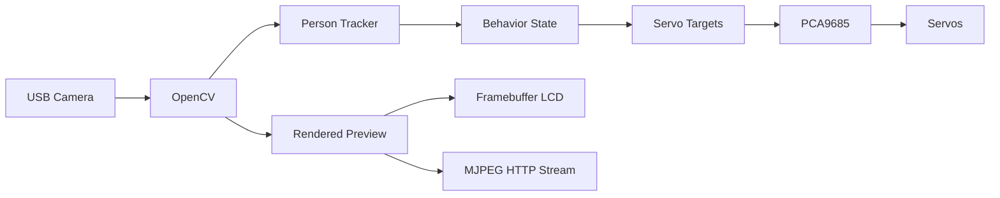

# Raspberry Pi Robot Arm

> [!WARNING]
> This is a physical robotic arm capable of causing injury. Keep people, hair, clothing, and loose objects clear during startup and `HOME`. Provide an accessible servo-power disconnect. Test every new movement range slowly. `Ctrl+C` or a service stop must disable PWM. Software limits do not replace continuous physical supervision.

A Raspberry Pi 5-controlled Hiwonder/LeArm robotic arm with camera-based person detection and tracking. The current build combines a PCA9685 servo controller at I2C address `0x40` and 50 Hz, six PWM servos, a USB camera, OpenCV, a mirrored framebuffer LCD preview, an optional MJPEG browser stream, and systemd startup.

This repository preserves the working controller plus calibration and experimental scripts. Many scripts can move real hardware. Read [SAFETY.md](docs/SAFETY.md) and [SERVO_MAPPING.md](docs/SERVO_MAPPING.md) before running anything.

## Architecture



## Features and status

| Feature | Status in this snapshot |
| --- | --- |
| `FOLLOW` person tracking | Working in `person_follow_camera.py` |
| `GREET` gesture | Working after sustained centered engagement |
| `HAPPY_DANCE` | Constants/telemetry retained, but no reachable dance sequence is implemented in the checked-in controller |
| Mirrored LCD preview | Working through pygame or direct 16-bit `/dev/fb0` output |
| `HELLO` during greeting | Intended behavior; the current overlay shows tracking/behavior state rather than a literal `HELLO` label |
| MJPEG web stream | Implemented; enabled with `--web-stream` |
| Light-react mode | Separate experimental controller, not part of normal autostart |
| Demo/random motion | Separate experimental scripts, not part of normal autostart |

## Hardware

- Raspberry Pi 5
- Hiwonder/LeArm six-servo robotic arm
- PCA9685 PWM controller (`0x40`, 50 Hz)
- Six PWM servos on channels 0–5
- USB camera
- Framebuffer LCD (optional for headless/browser-only use)
- Separate, correctly rated servo power supply with a readily accessible disconnect

The channel roles are:

| Channel | Role |
| --- | --- |
| 0 | Gripper |
| 1 | Expressive joint |
| 2 | Pointing/helper joint |
| 3 | Upright/support joint |
| 4 | Vertical tracking |
| 5 | Horizontal/base tracking |

See [hardware](docs/HARDWARE.md), [wiring](docs/WIRING.md), and the authoritative [servo mapping and range notes](docs/SERVO_MAPPING.md).

## Quick start

The documented baseline is Raspberry Pi OS Lite on a Raspberry Pi 5 with a project-local Python virtual environment at `.venv`. These commands describe the expected Raspberry Pi setup; they have not been run as part of this documentation update.

```bash
git clone https://github.com/monitronica/raspberry-pi-robot-arm.git
cd raspberry-pi-robot-arm
python3 -m venv .venv --system-site-packages
source .venv/bin/activate
python -m pip install --upgrade pip
python -m pip install adafruit-blinka adafruit-circuitpython-pca9685 adafruit-circuitpython-servokit
```

OpenCV, NumPy, pygame, and `python3-venv` are documented as Raspberry Pi OS packages in the full [installation guide](docs/INSTALLATION.md), which also maps every non-standard Python import to its package.

Before enabling motion, inspect the wiring, mechanically support the arm, clear its workspace, and keep a hand near the servo power disconnect. The working entry point requires two explicit motion acknowledgements and a `HOME` line on standard input:

```bash
printf 'HOME\n' | .venv/bin/python person_follow_camera.py \
  --track --confirm-motion-ready --preview --web-stream
```

Open `http://<raspberry-pi-hostname>:8080/` for the optional MJPEG view. Do not publish this unauthenticated stream to the internet.

## Documentation

- [Installation](docs/INSTALLATION.md)
- [Usage and modes](docs/USAGE.md)
- [Hardware](docs/HARDWARE.md)
- [Wiring](docs/WIRING.md)
- [Camera stream](docs/CAMERA_STREAM.md)
- [Servo mapping and ranges](docs/SERVO_MAPPING.md)
- [systemd autostart](docs/AUTOSTART.md)
- [Safety](docs/SAFETY.md)
- [Experiments](docs/EXPERIMENTS.md)

## Repository policy

Hardware behavior is intentionally left unchanged. Experimental motion files are retained for reference, clearly separated in the documentation, and should not be used as production entry points. Logs, media captures, virtual environments, credentials, keys, and local network configuration are excluded by `.gitignore`.

No license is declared in this snapshot. Add a `LICENSE` file before inviting reuse if you want to grant explicit open-source permissions.

