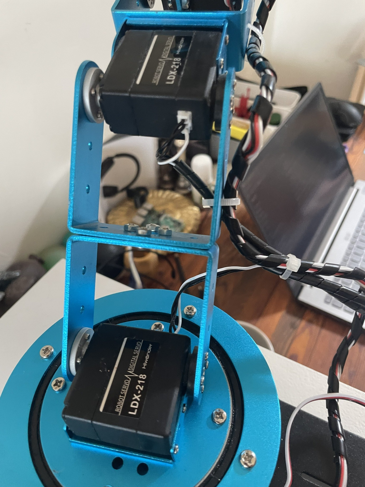
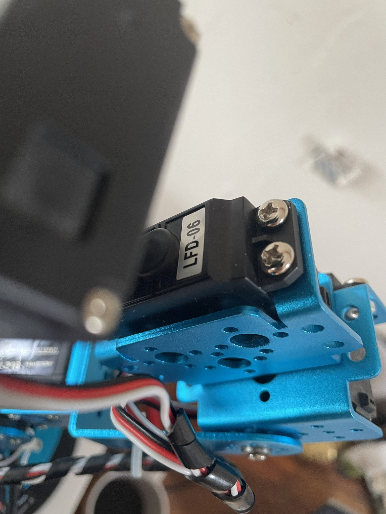
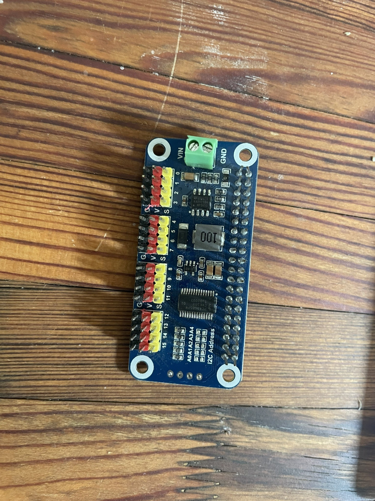
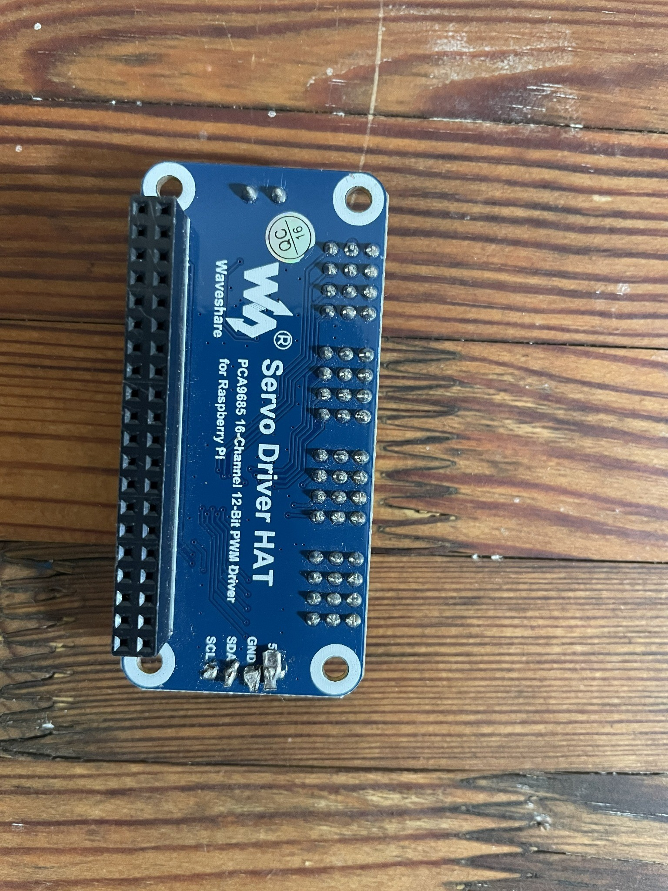

# Hardware

## Core components

| Component | Purpose |
| --- | --- |
| Raspberry Pi 5 | Runs OpenCV, behavior logic, preview, web stream, and PWM control |
| Hiwonder/LeArm | Six-servo mechanical arm |
| PCA9685 | Generates servo PWM on I2C bus 1 at address `0x40`, configured for 50 Hz |
| USB UVC/V4L2 camera | Supplies OpenCV frames for person detection and tracking; default request is 640×480 |
| Framebuffer LCD | Displays the mirrored local preview through writable `/dev/fb0`; direct output requires 16 bpp plus readable size/stride metadata |
| External servo supply | Approximately 7.9 V / 10 A for this build; powers the servos independently of the Pi logic rail |

## Physical hardware reference

<table>
  <tr>
    <td align="center"> Hiwonder servos installed in the arm structure.</td>
    <td align="center"> Installed servo marked LFD-06.</td>
  </tr>
</table>

<table>
  <tr>
    <td align="center"> PCA9685 servo driver HAT, component side.</td>
    <td align="center"> PCA9685 servo driver HAT, reverse side.</td>
  </tr>
</table>

The photographs identify the hardware used in this build; they do not add electrical or servo specifications beyond the documented configuration below.

## PCA9685 signal control

The Raspberry Pi controls the PCA9685 over I2C bus 1 using `SDA` and `SCL`; the controller is addressed at `0x40`. The PCA9685 converts those commands into six independent 50 Hz PWM control signals on channels 0–5. Each servo receives its position command from its channel's signal pin while drawing motor power from the separate external servo PSU.

The PCA9685 signal output does not power a servo. Reliable control requires correct logic power, I2C wiring, servo signal wiring, and the common ground described below.

## Power requirements

Do not power six moving servos from the Raspberry Pi 5 V pin. This build uses an external regulated servo supply of approximately 7.9 V / 10 A, sized for the arm's combined current demand. Verify that this voltage is permitted by every installed servo and the PCA9685 carrier's servo-power path before connecting it; do not copy the value to different hardware without checking its specifications.

**A common ground is required:** connect the external servo PSU negative/ground, PCA9685 ground, and Raspberry Pi ground together so the PWM signal has a shared electrical reference. Common ground does not mean joining the positive power rails; keep servo `V+` isolated from the Pi's 5 V rail.

## Corrected power isolation

The corrected arrangement prevents backfeeding between the Raspberry Pi/HAT logic supply and the external servo supply:

- The external PSU is the only source for the servos' positive power rail, routed through the build's verified isolated high-current path.
- The Raspberry Pi supplies or controls only the logic side of the PCA9685/HAT, as appropriate for the installed board.
- Do not tie the HAT's servo `V+` terminal into the external power arrangement unless the exact HAT schematic and corrected build wiring explicitly require it and confirm that the connection is isolated and correctly rated.
- Pi 5 V, HAT servo `V+`, and the external servo-positive rail are not casually bridged by wiring, a power-selection jumper, or an unintended carrier-board path.
- Grounds remain common for signal reference; positive rails remain isolated.

Before applying power, use the schematic and continuity checks appropriate to the exact PCA9685/HAT revision to confirm the intended servo-power route and that no backfeed path exists. Do this with all supplies disconnected. Do not assume that a terminal labeled `V+` is the correct external-power injection point, or that similarly shaped PCA9685 boards have identical power-jumper behavior.

Fit an accessible switch, fuse, or connector that removes servo power without depending on software. The Pi and camera may remain powered while the servo rail is disconnected for inspection.

## Interfaces used by the software

- I2C bus 1 for the PCA9685 at `0x40`
- `/dev/videoN` for a V4L2 USB camera
- `/dev/fb0` plus framebuffer metadata under `/sys/class/graphics/fb0/`
- TCP port 8080 for the main optional MJPEG stream
- systemd/journald for automatic startup and logs

The direct framebuffer backend expects `/dev/fb0`, 16 bits per pixel, readable `virtual_size`, `bits_per_pixel`, and `stride` metadata under `/sys/class/graphics/fb0/`, and write access for the runtime user. On systems with another configured display stack, pygame may provide the preview instead. MJPEG and headless processing do not require a framebuffer.

I2C must be enabled in Raspberry Pi OS before the controller is started. The expected Linux device is `/dev/i2c-1`; see the [installation guide](INSTALLATION.md) for a servo-power-disconnected verification procedure.

## Mechanical setup

Secure the base to a stable surface. Route cables with enough slack for the validated motion envelope, but away from gears and pinch points. Confirm every horn is installed at the expected neutral position before treating a 1500 µs command as mechanically centered.

