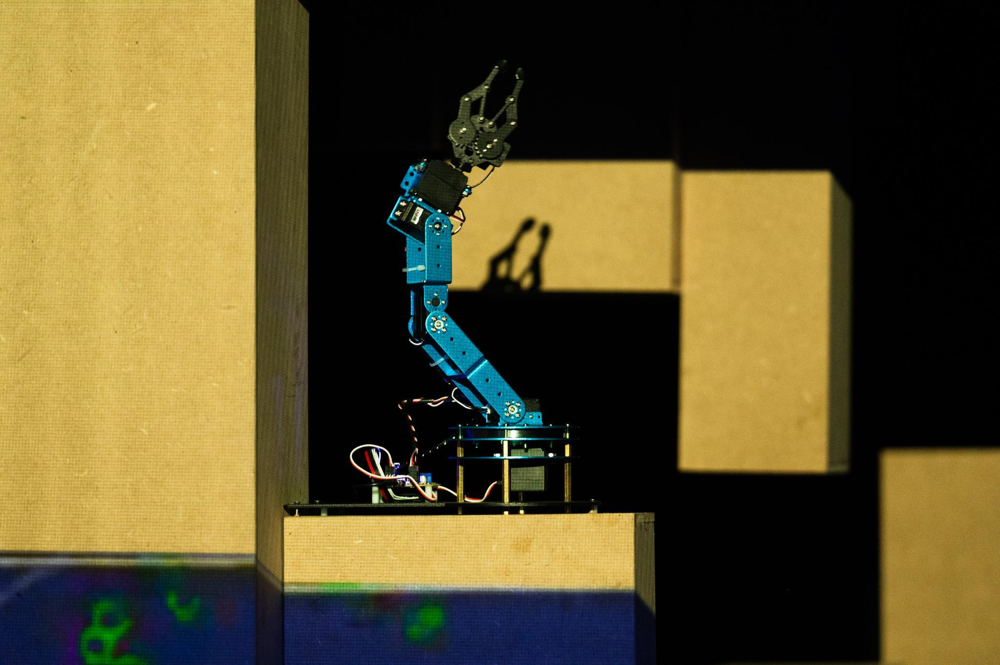

# Project history

## A Second Life for a Performing Robot

This robotic arm did not begin as a Raspberry Pi project.

Its first life was on stage as part of [*Apofenija/1*](https://www.melara.si/apofenija-1/), a performance by Nina Ramšak Marković and Varja Hrvatin. The work explored artificial intelligence, technology, liveliness, and the relationship between humans and machines. In the performance, robotic and technological entities occupied the stage as performers in their own right.

I worked on *Apofenija/1* as a technical co-author together with Staš Vrenko, and this robotic arm was one of the machines used in the production.

*The robotic arm in its earlier life as a performer in [Apofenija/1](https://www.melara.si/apofenija-1/). Photo: Gregor Salobir — used with permission.*

After the performance was retired, the arm continued into another context. It was reused as a practical medium for participants connected with [Digital on Stage](https://digitalonstage.eu/) activities at KIBLA, where it became a tool for experimenting with robotics in theatrical and performing-arts settings.

Eventually, the arm's original controller board died.

Rather than discard the machine, I decided to keep what was still useful: its "guts and muscles"—the mechanical structure, servos, wiring, and the physical history accumulated through its previous uses—and replace its brain.

The rebuild took place during [Circuit Control](https://circuit-control.de/?lang=en) in Dresden, a festival centred around creative electronics, soldering, DIY culture, knowledge exchange, and experimental making. It was an appropriate setting for the robot's next transformation: an obsolete controller was removed, the existing mechanics and servos were retained, and a Raspberry Pi 5 became the basis for a new control system.

This repository documents that transformation.

The project is therefore not only about making an old robotic arm move again. It is also an experiment in reuse, repair, adaptation, and technological afterlives.

I am interested in what happens when a machine moves from one project into another: from performer, to workshop tool, to experimental autonomous robot. Instead of continually replacing hardware, I want to explore how existing machines can be hacked, reprogrammed, and given another function.

The scratches, old servos, improvised wiring, obsolete components, repairs, and modifications are not something to hide. They are part of the history of the object.

**Keep the body, replace the brain, and see what the machine can become next.**

## Project lineage

### *Apofenija/1*

Original life as a robotic performer in a theatrical production.

### Digital on Stage / KIBLA

Reused as a hands-on medium for experimenting with robotics in performing-arts and theatrical contexts.

### Controller failure

The original controller/motherboard died, but the mechanics and servos were still usable.

### Circuit Control, Dresden

The robot was rebuilt during Circuit Control using the existing mechanical structure and servos while replacing the controller with a Raspberry Pi-based system.

### Current life

The arm now serves as an experimental platform for computer vision, person tracking, web streaming, autonomous movement, interaction, and new control methods.

## Future directions

The Raspberry Pi rebuild is not intended as a final form.

A future goal is to separate the robot's physical control layer from the interfaces used to command it.

Possible future directions include:

- [ROS or ROS 2](https://www.ros.org/) integration;
- a custom browser-based control interface;
- OSC or network control for performance environments;
- interfaces for performers and workshop participants;
- computer-vision-driven behaviour; and
- modular control so different projects can give the same physical machine a different "brain."

ROS integration is a future possibility, not a feature of the current system. ROS or ROS 2 could provide useful structure and interoperability in some settings, but a custom interface may be more appropriate for artistic and performance work. Such an interface could foreground immediacy, legibility, improvisation, and the needs of performers or workshop participants instead of requiring them to work through a general-purpose robotics framework.

The goal is not necessarily to turn the arm into a conventional industrial robot. It is to keep the machine open enough that its behaviour, interface, and role can continue changing from project to project. Keeping the control layer modular supports the larger aim of preserving and adapting the same physical robot rather than treating each new use as a reason to replace it.

## Image rights

The photograph `images/apofenija-performance-gregor-salobir.jpg` is by Gregor Salobir and is used in this repository with permission. It remains credited to Gregor Salobir and is not included in the repository's CC BY 4.0 license. See [LICENSE.md](../LICENSE.md) for the licensing scope and third-party-material notice.

## References

- [*Apofenija/1* — konS Platform](https://kons-platforma.org/projekti/apofenija-1/)
- [*Apofenija/1* — Zavod Melara](https://www.melara.si/apofenija-1/)
- [*Apofenija/1* — Moment](https://moment.si/predstava/apofenija-1/)
- [Maribor Is The Future #130: *Apofenija/1*](https://soundcloud.com/maribor-is-the-future/130-apofenija11)
- [*Apofenija/1* on Instagram](https://www.instagram.com/p/Cd5a7SmoKyt/)
- [Radio Maribor: premiere at GT22](https://radiomaribor.rtvslo.si/clanek/nocoj-v-gt22-premiera-interpretacije-cloveskega-ne-smisla/628084)
- [*Apofenija/1* video](https://www.youtube.com/watch?v=t5L9FEV1Gjo)
- [Digital on Stage](https://digitalonstage.eu/)
- [Circuit Control](https://circuit-control.de/?lang=en)
- [ROS: Robot Operating System](https://www.ros.org/)
