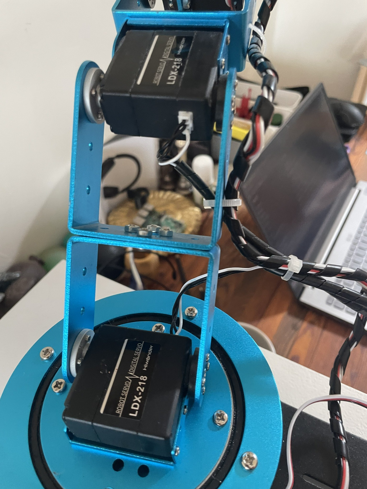
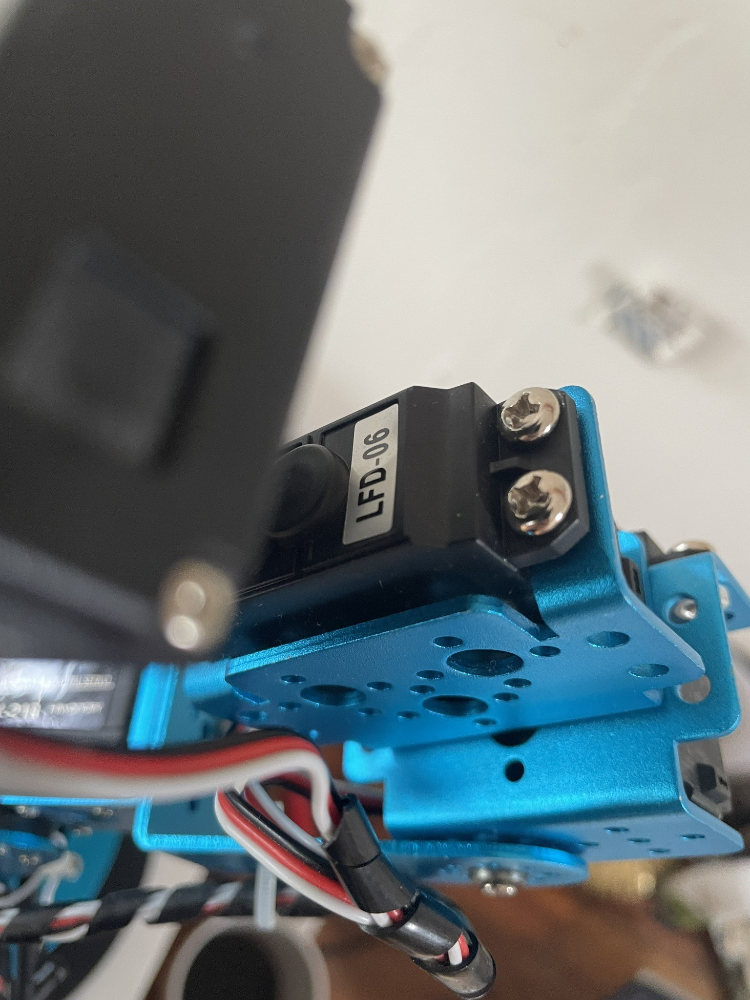

# Servo Mapping and Range Policy

Pulse widths in this project are microseconds at 50 Hz. They are installation-specific positions, not universal angles.

<table>
  <tr>
    <td align="center"> Installed arm joints and Hiwonder servos.</td>
    <td align="center"> Installed servo marked LFD-06.</td>
  </tr>
</table>

These photos are mechanical references only. They do not establish channel identity, pulse limits, direction, or safe travel; use the verified mapping and limits below.

## Current channel map

| Channel | Role | Home/center used by main controller | Main-controller software limits |
| --- | --- | ---: | ---: |
| 0 | Gripper | 1500 µs internal state | 1300–1750 µs for greeting; 1500–2000 µs idle expressive targets |
| 1 | Expressive joint | 1500 µs internal state | 1300–1750 µs for greeting; 1400–1600 µs idle expressive targets |
| 2 | Pointing/helper joint | 1500 µs | 1400–1600 µs in follow; 1300–1750 µs in greeting |
| 3 | Upright/support joint | 1500 µs | 1400–1600 µs |
| 4 | Vertical tracking | 1500 µs | 1000–1700 µs |
| 5 | Horizontal/base tracking | 1500 µs | 900–2100 µs |

The table reports clamps present in `person_follow_camera.py`; it does not certify that every value is mechanically safe on another arm.

## Three different meanings of “range”

### Hardware servo capability

The generic 500–2500 µs bounds found in `arm_home_calibration.py` are broad electrical/test bounds, not a safe operating envelope for the assembled arm. Actual capability depends on servo model, horn indexing, link geometry, load, supply voltage, and collisions. Never infer a joint's physical angle from pulse width alone.

### Software safety limits

The main controller clamps commands to the per-channel limits in the table. These are the only ranges to describe as current operational software limits. They reduce risk but cannot detect stalled joints, incorrect wiring, reversed geometry, mechanical obstruction, or a person entering the motion envelope. Software limits never replace continuous physical supervision and immediate access to the servo-power disconnect.

Channel 0 deserves special attention: idle expressive motion may target as high as 2000 µs, while greeting writes are clamped to 1750 µs. This difference is present in the working source and must be validated mechanically before relying on the idle expressive behavior.

### Experimental ranges

Experimental scripts use different bounds. Examples include:

| Experiment | Channels | Bounds |
| --- | --- | --- |
| `demo_stream_motion.py` | 3 / 4 / 5 | 1450–1550 / 1400–1600 / 1300–1700 µs |
| `random_three_servo_stream.py` | 3 / 4 / 5 | 1450–1550 / 1400–1600 / 1300–1700 µs |
| Light-react tracking | 4 / 5 | 1350–1650 / 1300–1700 µs |
| Retained dance constants | 0–2 conceptually | 1400–1650 µs; no reachable dance sequence in this snapshot |

Calibration and historical test scripts may contain wider values. Their existence is not evidence of safety.

## Range-testing procedure

1. Disconnect servo power and inspect horn alignment and possible collisions.
2. Secure the base, unload the gripper, and clear all people from the envelope.
3. Keep an accessible servo-power disconnect in hand.
4. Test one channel at a time near the known neutral position.
5. Increase travel in very small increments with long pauses.
6. Stop immediately for buzzing, heating, binding, sudden motion, or unexpected direction.
7. Record validated limits for the exact physical build; do not copy values blindly between arms.
8. Confirm `Ctrl+C`/service stop sets PWM duty cycles to zero.

