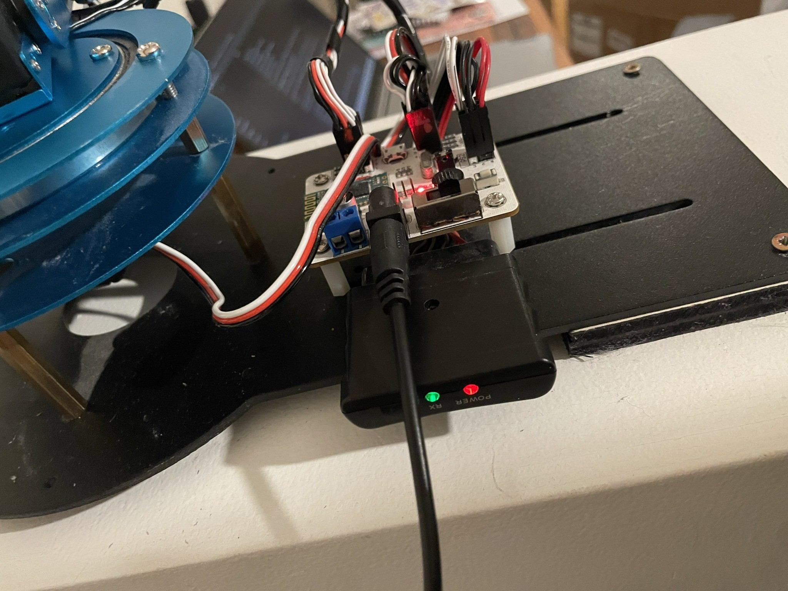
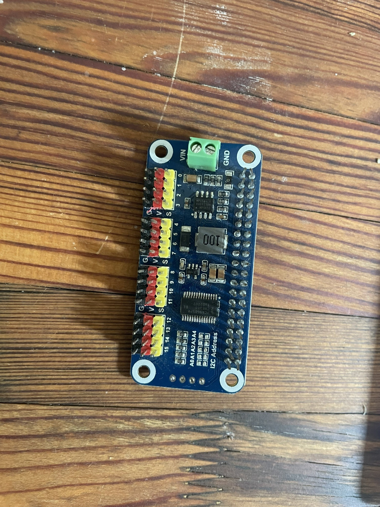
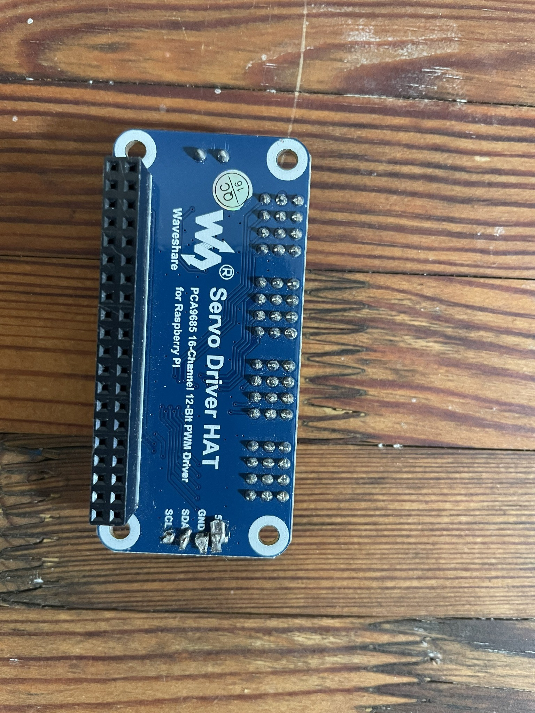

# Wiring

> [!CAUTION]
> Disconnect servo power while wiring. Verify polarity with the documentation for your exact PCA9685 board and power supply; clone boards do not always use identical connector layouts.

## Build reference photos

<p align="center">
  
</p>

<p align="center"><em>Reference photo of electronics installed at the arm base. This is not an electrical schematic and must not be used to infer hidden connections or polarity.</em></p>

<table>
  <tr>
    <td align="center"><br><sub>Board component side.</sub></td>
    <td align="center"><br><sub>Board reverse side.</sub></td>
  </tr>
</table>

These board photographs are orientation references only. Follow the printed labels, the exact board revision's documentation, and the verified power-isolation arrangement described below.

## Logical connections

| Raspberry Pi 5 | PCA9685 | Notes |
| --- | --- | --- |
| 3.3 V | Logic `VCC` | PCA9685 logic supply; do not substitute the high-current servo rail |
| Ground | `GND` | Must also share ground with the external servo supply |
| GPIO 2 / SDA1 (physical pin 3) | `SDA` | I2C data |
| GPIO 3 / SCL1 (physical pin 5) | `SCL` | I2C clock |

Route the approximately 7.9 V / 10 A regulated external servo supply through this build's verified, isolated high-current servo-power path with correct polarity. Verify that the exact servos, wiring, connectors, and any board in that path accept this voltage and current before applying power. Do not assume the PCA9685/HAT terminal marked servo `V+` is the correct place to inject external power.

### Backfeed prevention

The corrected power arrangement keeps the positive rails separate: the external PSU alone powers the servos through the verified isolated path, while the Raspberry Pi/HAT logic rail remains independently powered. **Do not tie the HAT servo `V+` into the external power arrangement unless the exact board schematic and corrected wiring plan explicitly require that connection.** Remove or configure any power-link jumper exactly as required by the specific HAT/carrier documentation so it cannot connect Pi 5 V, HAT servo `V+`, or the external rail in an unintended way. Never rely on appearance or a generic PCA9685 diagram to determine terminal or jumper behavior.

Only the grounds are intentionally joined. With all power disconnected, verify the intended isolation before first power-up. Backfeeding can damage the Raspberry Pi, PCA9685/HAT, supply, wiring, or USB-connected equipment.

## PCA9685 control path

```text
Raspberry Pi 5 -- I2C SDA/SCL --> PCA9685 at 0x40
PCA9685 CH0-CH5 -- 50 Hz PWM signal --> servo signal wires
External PSU -- verified isolated power path --> servo-positive rail
All grounds ---------------------------> common reference
```

The Pi sends target commands over I2C; it does not generate each servo pulse directly. The PCA9685 produces the position-control PWM signal at 50 Hz. Servo motor current comes from the external PSU, not from the PWM signal or the Pi logic supply.

## Common ground

The following grounds must be electrically common:

- Raspberry Pi ground
- PCA9685 logic/servo ground
- External servo PSU negative/ground

This shared ground provides the reference required for reliable PWM control. Join grounds only—do not join the approximately 7.9 V servo-positive rail to either the Raspberry Pi 5 V or 3.3 V rail.

## Servo outputs

| PCA9685 channel | Arm function |
| --- | --- |
| 0 | Gripper |
| 1 | Expressive joint |
| 2 | Pointing/helper joint |
| 3 | Upright/support joint |
| 4 | Vertical tracking |
| 5 | Horizontal/base tracking |

For each servo connector, confirm the marked ground, power, and signal order. Connect each servo signal wire to its assigned PCA9685 channel, its power wire to the verified external servo-positive distribution path, and its ground wire to the common ground. Do not use the HAT servo `V+` as a distribution point unless that exact connection has been confirmed for this board and corrected arrangement. Do not rely on wire color alone.

## Camera and display

- Connect the camera by USB and confirm Linux creates `/dev/videoN`.
- Connect/configure the LCD according to its vendor instructions so Linux exposes `/dev/fb0`.
- The camera image is mirrored for display only; tracking calculations use the original frame coordinate system.

## Pre-power checklist

1. Servo rail polarity is correct, and the approximately 7.9 V supply voltage is permitted by every installed servo and the controller board.
2. The external PSU is the only servo-power source and follows the verified isolated path; the HAT servo `V+` is not incorrectly tied into it.
3. Pi ground, PCA9685 ground, and external servo-PSU negative/ground are electrically common.
4. No servo cable is reversed.
5. The base is secured and all joints can move through the intended narrow range without collision.
6. The servo-power disconnect is reachable.
7. The work area is clear before `HOME`.

